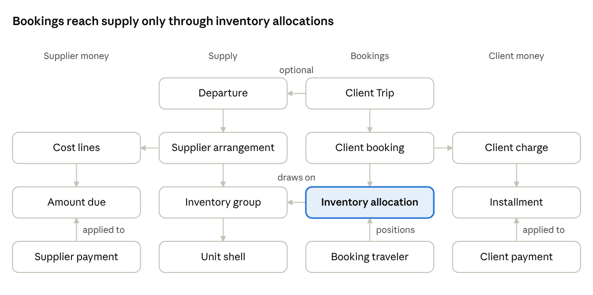

# Slice 1 data model

**Status:** Reviewed 2026-11-03 for the Phase 0 checkpoint. Part of the [first-slice charter](first-slice-charter.md). The working copy is the "Slice 1 data model" tab of the [charter working doc](https://claude.ai/artifact/CyxyKhNu7FWBFdG3MXCUHo); change that copy first, then update this file.

Slice 1 needs 56 entities: 11 reused or adapted from the existing app and 45 new, written to the spec rules the charter cites. Each table marks an entity Reuse, Adapt or New, with its key facts and the rules it serves. Field names are indicative; the build settles exact columns.

## At a glance

Supply and bookings meet only through the inventory allocation, and supplier and client money never link to each other directly. Supplier reservations, tasks and documents hang off these records and are listed in the tables below.

## Foundation

The foundation is kept, with four adaptations: permissions replace roles, offices lose their time zone, the agency gains client-facing profile fields, and resellers are added.

| Entity | Status | Key facts | Rules |
| --- | --- | --- | --- |
| Agency | Adapt | Keep name, legal name, agency code, default currency and time zone. Add display name, contact email, phone, mailing address, seller-of-travel disclosure, document footers, hold duration (2 days by default), installment buffer (14 days by default) | SET-01, SET-04, SET-09, BKG-09, CMN-10 |
| Office | Adapt | Drop its own time zone; offices use the agency's | SET-12 |
| Agency user | Adapt | Replace the administrator, staff and viewer role with a user type: Agency Admin, staff or reseller user. A reseller user belongs to one reseller | ACC-02, ACC-05, ACC-07 |
| User permission | New | One row per user and permission: Departure management, Supplier arrangements, Financial records, Passport access, Reseller relationships. Agency Admins hold all five implicitly | ACC-11, ACC-30, ACC-31 |
| Reseller | New | Name, status (active, booking paused, suspended, ended), direct-contact setting | ACC-13, ACC-16, DOC-08 |
| Audit event | Reuse | Actor, agency, subject, action, changed fields | ACC-23, ACC-24 |
| Reference sequence | Adapt | Add namespaces for trips, payments, arrangements, supplier payments and documents; booking references derive from the trip | REF-02 to REF-07 |
| Client, client person, client organization, contact points | Adapt | Add created by, so staff can review reseller-created profiles (D-78) | CLT-01, CLT-21, CLT-27 |
| Supplier, supplier contact, supplier category | Reuse | Unchanged | SUP-01 |

## Departure, suppliers and inventory

One arrangement record per supplier per Departure replaces the versioned arrangement; changes are dated events, and every allocation points at an inventory group or a unit shell.

| Entity | Status | Key facts | Rules |
| --- | --- | --- | --- |
| Departure | Adapt | Replace the single status with three: sales status (Draft, Ready to sell), operating decision (Undecided, Proceed, Postpone, Cancel), completion (Active, Departed, Cancelled, Superseded); reconciliation is recorded on the margin snapshot, not as a status (D-86). The summary label is derived. Optional overrides of the hold duration and installment buffer | DEP-01, DEP-03, DEP-04, D-86 |
| Departure team member | New | Departure, staff user, default task owner flag | ACC-09, OPS-12 |
| Payee account | New | Supplier, name, currency, payment instructions | SUP-02 |
| Supplier arrangement | New | Departure, supplier, status (Draft, Confirmed, Closed, Cancelled), obligation shape, group reference, reservation scope (arrangement, per unit, none), currency, terms text and documents | SUP-06, SUP-07, SUP-10, SUP-11, SUP-16 |
| Inventory group | New | Arrangement, service category, representation (unit shells, pool, none), availability promise, service start and end with time zone, category code, maximum occupancy, option cutoff | INV-01 to INV-04, SUP-15 |
| Unit shell | New | Group, label, positions; supplier assignment and unit confirmation when known. Excursion resources are shells with 10 positions (INV-16) | INV-05, INV-06, INV-38 |
| Inventory event | New, or adapt the capacity ledger after the spike | Group or shell, kind (opening, increase, supplier release, correction), quantity, effective date, evidence | INV-26 |
| Capacity rule | New | Group, traveler type, uses capacity yes or no; for children 0–4 who use no position (INV-39) | M1 |
| Supplier rate line | New, porting the existing cost-component design | Group, occupancy position, traveler type, base fare, non-commissionable fees, taxes, discount, commission | SUP-35, D-75 |
| Supplier deadline | Adapt existing types and rule shapes | Arrangement or group, type, actionable or informational, local date, time and zone, resolved instant | SUP-22 to SUP-24 |
| Supplier reservation | New | Arrangement optional, booking optional, scope, status (Requested, Confirmed, Declined, Cancelled), supplier reference, linked shells or allocations | INV-33 to INV-37 |

## Offerings and client terms

Offerings are new, simpler tables; the existing package tables' cancellation tiers and schedule lines are the pattern for client terms.

| Entity | Status | Key facts | Rules |
| --- | --- | --- | --- |
| Offering | New | Departure, name, kind (package or standalone service), currency, current terms version | BKG-13 |
| Offering component | New | Offering, inventory group or arrangement, included or add-on | BKG-13, BKG-16 |
| Choice | New | Offering, name, scope (per traveler, per unit, per trip), pattern (required single, optional single, optional multiple) | BKG-14 |
| Choice option | New | Choice, label, inventory group it draws from | BKG-14, BKG-15 |
| Traveler type | New | Agency-defined label such as Adult, Child, Child 0–4 | BKG-21 |
| Price | New | Offering or option, traveler type, occupancy position, amount. Changing a price never touches a booking | BKG-21, BKG-23 |
| Client terms version | New | Departure or offering, optionally copied from another Departure's terms; wording; immutable once a booking accepts it (D-76) | BKG-28 |
| Cancellation tier | Adapt the existing tier shape | Terms version, cutoff, percentage or fixed amount, base | BKG-31 |
| Payment schedule line | Adapt the existing line shape | Terms version, amount basis (per traveler, per unit of a named service category, per booking, or percentage), due rule | CMN-09, D-76, D-77 |
| Offering publication | New | Offering, reseller channel (one per reseller relationship, so the relationship itself in Slice 1), published and withdrawn times | DEP-07, ACC-14, D-68 |

## Clients, trips and bookings

Everything here is new. Booking status, allocation state and supplier reservation status are three separate columns on three records; none is derived from another.

| Entity | Status | Key facts | Rules |
| --- | --- | --- | --- |
| Traveler | New | Given names, middle name, surname, suffix, preferred name, date of birth, supplier-required gender or sex, contact points, created by (D-78). No passport fields in Slice 1 | CLT-05, CLT-06, CLT-28 |
| Traveler link | New | Traveler, client, relationship (Self, Family member, Employee or member, Other) | CLT-09 to CLT-11 |
| Client Trip | New | Responsible client, Departure (optional), reference. Status is derived from its bookings | CLT-02, OVR-02, BKG-03 |
| Client booking | New | Trip, offering (optional), sequence, status (Draft, Confirmed, Discarded, Cancelled), creator, owner (a reseller or the agency), seller of record, cancellation initiator | BKG-05, BKG-06, ACC-18 |
| Booking traveler | New | Booking, traveler or placeholder label, traveler type, occupancy position, name as booked, active or cancelled | CLT-13, CLT-15, BKG-55 |
| Choice selection | New | Booking, option, the traveler or unit it applies to | BKG-14, BKG-16 |
| Inventory allocation | New | Booking, inventory group and quantity, or a unit shell; state (Held, Reserved, Released), hold expiry, extended once (BKG-09). "Conditional" and "capacity conflict" are derived, not stored | INV-17 to INV-23, BKG-09 |
| Allocation position | New | Allocation, booking traveler, position number | INV-07 |
| Acceptance record | New | Booking, who accepted, method, time, terms version, evidence, who recorded it, linked payment if the terms make payment acceptance | BKG-39, BKG-41 |

## Money

All money is integer minor units with a currency code. Records are append-only: corrections are reversals, and balances are calculated from applications, never stored.

| Entity | Status | Key facts | Rules |
| --- | --- | --- | --- |
| Cost line | New, porting the existing cost-component bases | Arrangement, scope (arrangement, group, shell, booking or traveler), basis (fixed, per unit, person, night or occupancy position, or percentage), rate, estimated or committed; proposed per booking from the rate table at confirmation, or staff-entered for unsold space, such as the first excursion resource and the firm Nov 5 hotel rooms (D-75) | SMN-02, SUP-13 |
| Schedule line | New | Cost line or arrangement, amount or basis, due rule (fixed date, event, event plus lag, earlier of event and date), trigger type | SMN-04 |
| Trigger event | New | Arrangement, type, date it happened, count, reference; for Client booking confirmed, the booking and the shells it holds (D-81) | SMN-11 to SMN-14 |
| Amount due | New | Schedule line, shell for per-unit lines (at most one per shell per line), snapshotted amount, due date, supplier invoice reference; paid status derived (D-81) | SMN-05, SMN-06 |
| Supplier payment | New | Payee account, date, amount, currency, method, reference, reversal link | SMN-18, SMN-23 |
| Supplier payment application | New | Payment, amount due, amount | SMN-19 |
| Expected commission | New | Booking service, supplier, amount, status (Expected, Confirmed, Received, Offset, Reversed) | SMN-32, SMN-33 |
| Client charge | New | One per confirmed booking, currency | CMN-01 |
| Charge line | New | Charge, type, traveler (optional), amount, creditor, expected route; never edited after creation | CMN-01 to CMN-03 |
| Installment | New | Charge, amount, due date, expected route | CMN-08, CMN-12 |
| Client payment | New | Trip, payer (a client), date, amount, currency, route (agency or supplier), supplier if supplier-direct, method, reference, reversal link | CMN-18, CMN-27 |
| Payment application | New | Payment, installment, amount. An unapplied remainder is the trip's credit | CMN-21, CMN-23 |
| Refund due | New (1b) | Trip, amount, issuer, authorized by, expected date | CMN-38 |

## Tasks, documents and margin

| Entity | Status | Key facts | Rules |
| --- | --- | --- | --- |
| Task | New | Source (deadline, schedule line, manual), action, due instant, owner, status (Open, In progress, Completed, Waived), completion note, linked record; overdue derived | OPS-02, OPS-03 |
| Document version | New | Type, number, version, subject record, rendered PDF, snapshot of displayed values; immutable | DOC-11, DOC-12 |
| Delivery record | New | Document version, recipient, method (manual in Slice 1), date, who recorded it | DOC-19, DOC-21 |
| Margin snapshot | New | Departure, projected or actual, published time, figures; for actual, reconciled by and at, and reopened by, at and why; earlier snapshots kept (D-86) | FIN-17, DEP-45, DEP-46 |

Projected margin is calculated on demand; only actual margin is snapshotted, at reconciliation.

## Open modeling questions

- [ ] **Capacity ledger:** adapt the existing ledger or replace it. The Phase 1 spike decides.
- [ ] **Unit shells versus resources:** the existing resources look like categories counted as units. Confirm, then decide whether shells are new rows or an extension.
- [x] **Accepted price snapshot:** settled: the charge lines alone are the snapshot (BKG-25).
- [x] **Supplier-held funds:** settled: a balance derived from supplier-route payments on agency-owed lines; dispositions arrive with held-fund offsets in a later slice.
- [x] **Old package tables:** settled: D-66 deletes them in Phase 1, after the spike.
