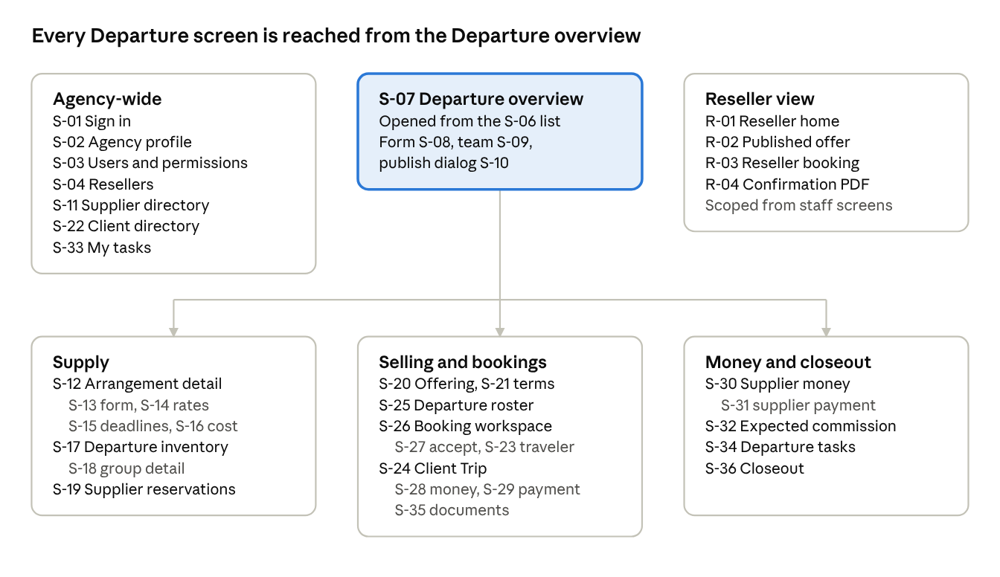

# Slice 1 screens

**Status:** Reviewed 2026-11-03 for the Phase 0 checkpoint. Part of the [first-slice charter](first-slice-charter.md). The working copy is the "Slice 1 screens" tab of the [charter working doc](https://claude.ai/artifact/CyxyKhNu7FWBFdG3MXCUHo); change that copy first, then update this file.

Slice 1 needs 36 staff screens and 4 reseller screens. The reseller screens are scoped versions of staff screens, not separate designs. Every screen cites the charter's workflow step, the D-cases it must pass and the rules it shows; all must meet UI acceptance at desktop width and 375px.

Kind is Page (its own URL), Panel (a section inside a page) or Dialog. Who is Admin, Staff (baseline), Fin (Financial records permission) or Reseller. This is a proposed inventory for review, not a record of what the existing app has.

## At a glance

Agency-wide screens sit outside any Departure. Inside a Departure, a tab bar under its header links the areas in the order the work runs: Overview, Suppliers, Inventory, Package, Client terms, Bookings, Money, Tasks and Closeout, each its own page (UX consolidation pass, D-98). Indented grey lines are panels and dialogs inside the screen above them. S-05 Change history appears on every record.

## Foundation and access

Five screens, mostly adapting what the app already has. Permissions replace roles on the users screen; resellers are new.

| ID | Screen | Kind | Step | Who | Shows and does | D-cases | Rules |
| --- | --- | --- | --- | --- | --- | --- | --- |
| S-01 | Sign in | Page | 1 | Staff, Reseller | Email and password; lands staff on My tasks, resellers on their home | D15 | ACC-02 |
| S-02 | Agency profile | Page | 1 | Admin | Display and legal name, contact details, seller-of-travel disclosure, document footers, time zone, default currency, traveler types (Adult, Child, Child 0–4), hold duration, installment buffer |  | SET-01, SET-04, SET-09, SET-10, BKG-09, BKG-21, CMN-10 |
| S-03 | Users and permissions | Page | 1 | Admin | Users with user type and the five permissions as checkboxes; invite; reseller users show their reseller |  | ACC-07, ACC-30, ACC-31 |
| S-04 | Resellers | Page | 9 | Admin | List and detail: status, direct-contact setting, users, assigned bookings, publications |  | ACC-13, ACC-14 |
| S-05 | Change history | Panel | All | Staff | Audit events on any record: who, when, which fields |  | ACC-23, ACC-24 |

## Departure and suppliers

The Departure overview is the hub: it answers the charter's four questions (what the client accepted, what the supplier confirmed, how capacity is used, what money is open) and doubles as the Slice 1 Departure summary. Arrangements carry their rate table, deadlines and cost as panels rather than separate pages.

| ID | Screen | Kind | Step | Who | Shows and does | D-cases | Rules |
| --- | --- | --- | --- | --- | --- | --- | --- |
| S-06 | Departures | Page | 2 | Staff | List with derived status label, dates, confirmed and draft bookings, space left in each choice the package includes (such as Cabin: 29 of 32 left), and money still due from clients; date filters behind a disclosure (UX consolidation pass, D-98) |  | DEP-04, CMN-06 |
| S-07 | Departure overview | Page | 2 | Staff | Three statuses and the derived label; Ready to sell? while a Draft; summary panels for bookings (and those awaiting a supplier), space left in what the package includes, client money and supplier money (separate, never netted), and the next tasks, each linking its tab and shown only to staff who may see that tab; status and details, operating decision and team; a Mark as Departed prompt once the last service date has passed (D-83) | D4 | DEP-01, DEP-03, DEP-04, CMN-06, SMN-05, OPS-01 |
| S-08 | Departure form | Page | 2 | Staff | Identity, dates, currency, time zone, optional hold duration and installment buffer overrides; saves as Draft with required fields missing | D16 | DEP-01, DEP-05 |
| S-09 | Departure team | Panel | 2 | Staff | Team members and the default task owner |  | ACC-09, OPS-12 |
| S-10 | Publish to reseller | Dialog | 9 (D-90) | Staff | Set Ready to sell, choose the offering and the one reseller channel; refused with reasons if not ready |  | DEP-06, DEP-07, FIN-22 |
| S-11 | Supplier directory and detail | Page | 3 | Staff | Existing directory plus one payee account per supplier: currency and payment instructions |  | SUP-01, SUP-02 |
| S-12 | Arrangement detail | Page | 3 | Staff | Sub-pages under section tabs, each its own page (UX consolidation pass, decision 3): Overview with the Ready to confirm? checklist and the details (status, group reference, payee, obligation shape, reservation scope, terms); Inventory; Rates and cost (S-14, S-16 cost); Payments and deadlines (S-16 payments, S-15); Reservations (S-19); Documents. Rates and cost and Documents need supplier cost access, and without it Payments and deadlines shows deadlines only | D1 | SUP-06, SUP-07, SUP-11, SUP-12, ACC-31 |
| S-13 | Arrangement form | Page | 3 | Staff | Create and edit; saves as Draft with required fields missing | D16 | SUP-06, SUP-09 |
| S-14 | Supplier rate table | Panel | 6 | Fin | Matrix of inventory group by occupancy position: base fare, non-commissionable fees, taxes, discount, commission; the form sample's rate editor | D1 | SUP-35, D-75 |
| S-15 | Supplier deadlines | Panel | 4 | Staff | Deposit, names, final payment, final count; actionable or informational; local time and zone with the resolved instant; each links its task | D12 | SUP-22 to SUP-25 |
| S-16 | Cost and schedule | Panel | 6 | Fin | Cost lines with basis and estimated or committed, on Rates and cost; schedule lines with due rules, amounts due and trigger events such as booking confirmation (D-81), on Payments and deadlines; add a commitment for unsold space naming its shells (D-75). The cost line form shows only the fields its scope and basis use and sums the line up in a sentence; the event form asks for a count only for an event a count-based payment waits on | D2 | SMN-01 to SMN-06, SMN-11, SMN-14 |

## Inventory and package

Inventory is one Departure-level page that shows every group the Alpha fixture needs: 32 cabin shells, the Nov 5 room shells, Nov 4 as a limited group, Nov 1 to 3 on request, and the excursion resource. Derived states (Conditional, capacity conflict, shell status) are displayed, never edited.

| ID | Screen | Kind | Step | Who | Shows and does | D-cases | Rules |
| --- | --- | --- | --- | --- | --- | --- | --- |
| S-17 | Departure inventory | Page | 5 | Staff | Groups by category with availability promise; shells as a grid with derived status; positions used and left; children 0–4 listed without positions | D4, D6 | INV-01 to INV-05, INV-07, INV-38, INV-39 |
| S-18 | Inventory group detail | Page | 5 | Staff | Shells or pool, capacity rule by traveler type, option cutoff, allocations against it, and the inventory event history. The supply change form sums the change up in a sentence, including any shortfall against what bookings hold; a refused change or capacity rule keeps what was typed and shows the error on the page |  | INV-09, INV-12, INV-16, INV-26 |
| S-19 | Supplier reservations | Page | 11 | Staff | Requests per arrangement or standalone; status Requested, Confirmed, Declined, Cancelled; record the supplier's reference; Awaiting supplier on the booking | D8 | INV-33 to INV-37 |
| S-20 | Offering editor | Page | 7 | Staff | Package components, included or add-on; choices with scope and pattern (cabin as required single per unit); options drawing on groups; prices by traveler type and occupancy position |  | BKG-13 to BKG-16, BKG-21 |
| S-21 | Client terms | Page | 7 | Staff | Terms version wording, cancellation tiers, payment schedule with per-cabin deposit; start by copying another Departure's terms; locked once a booking accepts it |  | BKG-28, BKG-31, CMN-09, D-76, D-77 |

## Clients, trips and bookings

The booking workspace is the heaviest screen in the slice. It keeps booking status, allocation state and supplier reservation status as three separate labels, and every blocked action says why and what to do next.

| ID | Screen | Kind | Step | Who | Shows and does | D-cases | Rules |
| --- | --- | --- | --- | --- | --- | --- | --- |
| S-22 | Client directory and profile | Page | 8 | Staff | Existing person and organization clients, plus linked travelers with relationship; Created by reseller filter (D-78) |  | CLT-01, CLT-09 to CLT-11, CLT-25 |
| S-23 | Traveler form | Dialog | 8 | Staff | Names, preferred name, date of birth, supplier-required gender or sex, contact points; no passport fields |  | CLT-05, CLT-06 |
| S-24 | Client Trip | Page | 8 | Staff | The trip's summary (UX consolidation pass, decision 7): responsible client, reference, Departure and derived status; each booking in brief (status, space, supplier status, services, acceptance, total and still due) with its travelers listed under it; what's next (drafts to finish, services awaiting a supplier, the next amount due); money (S-28) and documents (S-35). Printable from the browser (decision 8) |  | CLT-02, BKG-03 |
| S-25 | Departure roster | Page | 10 | Staff | Every booking on the Departure: owner (agency or reseller), status, cabin, travelers, subtotal, balance; Hold expired shown with its time (D-80); totals row | D4 | BKG-06, ACC-18 |
| S-26 | Booking workspace | Page | 10 | Staff | A read-only Summary (UX consolidation pass, decision 7): travelers and where each is placed, each service with its price, space and supplier status, acceptance, money and what's next, each section linking to its step, printable from the browser (decision 8). Then five steps: Travelers (placeholders allowed on holds); Rooms and options (cabin choice, travelers placed in positions, add-ons); Price and installments (price summary, proposed installments); Hold space (hold expiry, Hold expired once lapsed, D-80; Hold, Extend hold once); Accept and confirm (Record acceptance, Confirm with blocked reasons; missing fields listed and linked). Once confirmed, Money: the booking's balances, installments and each payment applied to it (decision 4). A confirmed booking opens on its Summary; a draft on its first step not done | D4, D5, D6, D16 | BKG-05, BKG-09 to BKG-11, BKG-25, BKG-45, BKG-46, INV-17 to INV-23, CMN-08, CMN-28 |
| S-27 | Record acceptance | Dialog | 10 | Staff, Reseller | Who accepted, method, time, terms version, evidence; links the payment when the terms make payment acceptance | D5 | BKG-39, BKG-41 |

## Money, tasks, documents and closeout

Client money and supplier money are separate sections of the Departure's Money tab (UX consolidation audit, decision 2): never netted, and no client record links to a supplier record. A trip's own money stays on the trip. Balances are always shown as calculated from applications, with the trip's unapplied credit visible.

| ID | Screen | Kind | Step | Who | Shows and does | D-cases | Rules |
| --- | --- | --- | --- | --- | --- | --- | --- |
| S-28 | Trip money | Panel | 12 | Staff, Fin | Charge lines, installments with due dates, payments by route, applications, credit and open balance; agency cash and supplier-direct payments shown apart | D9 | CMN-01 to CMN-03, CMN-06, CMN-08, CMN-21, CMN-23, CMN-55 |
| S-29 | Record client payment | Dialog | 12 | Fin | Payer, date, amount, route (agency or supplier, and which supplier), method, reference; applies to installments; issues a receipt for agency payments only | D9 | CMN-18, CMN-19, CMN-29 |
| S-30 | Supplier money | Money tab section | 13 | Fin | Amounts due by supplier and arrangement, due date, supplier invoice reference, derived paid status | D2, D10 | SMN-05, SMN-06, SMN-22 |
| S-31 | Record supplier payment | Dialog | 13 | Fin | Payee account, date, amount, method, reference; applied to amounts due; reversal instead of edit | D10 | SMN-18, SMN-19, SMN-23 |
| S-32 | Expected commission | Panel | 13 | Fin | Per booking service and supplier: amount and status Expected, Confirmed, Received, Offset, Reversed | D14 | SMN-32, SMN-33 |
| S-33 | My tasks | Page | 4 | Staff | The user's open tasks by due instant, overdue derived; complete or waive with a note | D12 | OPS-01 to OPS-05 |
| S-34 | Departure tasks | Panel | 4 | Staff | Every task on the Departure with source, owner and status; reassign | D12 | OPS-02, OPS-03 |
| S-35 | Documents | Panel | 15 | Staff | Issue confirmation, invoice and receipt as PDFs; version list; record manual delivery; no dates of birth on output | D13 | DOC-01, DOC-03, DOC-11, DOC-21, DOC-24 |
| S-36 | Closeout | Page | 15 | Fin | Mark Departed; reconciliation checklist with blockers; Reconciled label and reopen with a reason, keeping earlier snapshots (D-86); projected and actual margin in USD; seller of record | D14 | DEP-42 to DEP-44, DEP-46, FIN-01, FIN-17, FIN-18, FIN-20 |

## Reseller view

Four screens, each built from a staff screen with server-side scoping, so the reseller never sees supplier cost, commission or margin and cannot enter money. The mockup shows these as a scoped variant, not a view switch.

| ID | Screen | Based on | Step | Shows and does | Hidden or refused | D-cases | Rules |
| --- | --- | --- | --- | --- | --- | --- | --- |
| R-01 | Reseller home | S-06, S-25 | 9 | Published offers and the bookings assigned to this reseller, with Hold expired shown | Unassigned bookings, other channels | D15 | ACC-14, DEP-07 |
| R-02 | Published offer | S-20 | 9 | Package, choices, client prices and availability at the published price | Supplier cost, rate table, inventory detail | D15 | DEP-07, BKG-13 |
| R-03 | Reseller booking | S-26, S-27 | 10 | Create the client and travelers (no duplicate check), hold, record acceptance and confirm BK-105; balance due and payment details to pass on | Recording a payment is refused with a reason; no commission or margin | D15 | ACC-15, CLT-25, CMN-19, CMN-52 |
| R-04 | Booking confirmation | S-35 | 15 | Download the confirmation PDF for an assigned booking | Invoice and receipt issuing | D15 | DOC-01, ACC-14 |

## Slice 1b additions

Slice 1b adds no new pages. Each case adds an action or a state to a Slice 1 screen.

| Case | Screen | Adds |
| --- | --- | --- |
| D3 | S-12, S-26 | Agreement B on the arrangement; a Conditional hold showing the Mar 1, 2027 cutoff and its task |
| D7 | S-26, S-18 | Add-on amendment after confirmation, blocked for capacity until staff record a confirmed second resource as a dated increase |
| D8 | S-19, S-26 | A declined night flagged on the booking; acceptance kept, nothing cancelled |
| D11 | S-26, S-28 | Cancel a booking: inventory returned, supplier commitment unchanged, refund due entered |
| D17 | S-35 | Reissue an invoice; the earlier version shown as superseded |
| 1b margin | S-36 | The negative excursion margin case, −$350 |

## Open screen questions

- [x] **Departure areas as tabs or pages:** settled 2026-11-03: tabs, each its own page with its own URL, under a persistent Departure header. Tabs: Overview, Bookings, Inventory, Suppliers, Supplier money (hidden without Financial records), Tasks, Closeout. Reordered by the UX consolidation pass (D-98) to Overview, Suppliers, Inventory, Package, Client terms, Bookings, Money, Tasks; Money shows its client section to anyone who may see client money and its supplier section only with supplier costs. The booking workspace is a drill-down page under Bookings; the reseller view has no tabs; at 375px the tab bar scrolls inside its own strip.
- [ ] **Reuse of existing views:** which existing screens (client and supplier directories, sign-in, audit) carry over unchanged, and which cruise and hotel screens are frozen with M3?
- [ ] **Wide grids at 375px:** the rate table already switches to one profile column; do the inventory shell grid (S-17) and roster (S-25) need the same pattern?
- [ ] **Booking workspace shape:** one long page with sections, or steps (travelers, choices, price, acceptance) for the hold-to-confirm path?
- [ ] **Financial records gating:** should staff without Fin see amounts due and commission read-only, or not at all?
